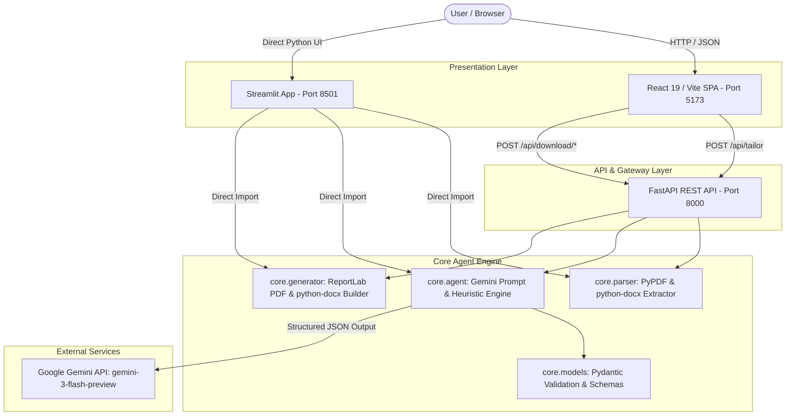

# System Design Document (SDD): Resume Tailorer & ATS Optimizer Agent
**Document Type:** Living Specification & Architecture Master  
**Version:** 1.0.0  
**Status:** Approved / Active Baseline  
**Last Updated:** 2026-10-20  

---

## 1. Executive Summary & Vision

The **Resume Tailorer Agent** is an enterprise-grade AI system designed to solve the asymmetric friction in automated hiring pipelines. Candidates frequently fail Applicant Tracking System (ATS) screening filters despite possessing relevant skills, because their resumes lack targeted role keywords, structured metric statements, or standardized parsing formats.

This system ingests an original candidate resume (PDF or DOCX) alongside a target Job Description (JD), applies generative natural language processing via Google Gemini to align qualifications, structures impact bullet points using Google's **XYZ Formula** (*"Accomplished [X], as measured by [Y], by doing [Z]"*), and produces an ATS-optimized, downloadable resume in both **PDF** and **Word DOCX** formats, alongside comprehensive scoring analytics.

---

## 2. High-Level System Architecture

---

## 3. Core Functional Requirements (FR)

| ID | Requirement | Description | Status |
|---|---|---|---|
| **FR-01** | Dual Document Ingestion | Accept resumes and JDs via `.pdf`, `.docx`, or raw text input. | Complete |
| **FR-02** | Secure API Key Management | Load `GEMINIAI_API_KEY` / `GEMINI_API_KEY` from `.env` internally without user prompting. | Complete |
| **FR-03** | JD Keyword Extraction & Categorized Competencies | Extract tools, libraries, methodologies, and map them into structured, categorized competencies (`Primary Expertise`, `AI-Assisted Development`, `Tools & Ecosystem`, `Secondary/Exposure`). | Complete |
| **FR-04** | Google XYZ Metric Rewriting | Transform flat experience descriptions into quantifiable impact metrics. | Complete |
| **FR-05** | Multidimensional ATS Scoring | Generate numeric ATS compatibility score (0-100) across 4 defined categories. | Complete |
| **FR-06** | ATS-Compliant Document Output | Render clean, single-column, standard typography files in PDF and DOCX format. | Complete |
| **FR-07** | Dual Delivery Interfaces | Provide both a decoupled modern full-stack web app and a rapid Streamlit Python app. | Complete |

---

## 4. Non-Functional Requirements (NFR)

1. **Performance**: Document parsing and structuring round-trip under 6 seconds on active network.
2. **Deterministic Output**: LLM temperature fixed at `0.2` with strict JSON Schema enforcement.
3. **Graceful Degradation**: Intelligent heuristic fallback engine triggers automatically if API calls time out or if offline.
4. **Security**: Zero persistent storage of candidate resumes on disk; inputs are processed in-memory.

---

## 5. Living Spec Modular Organization

In accordance with SDD standards, this repository maintains distributed living specs for each component:

| Component | Spec Path | Scope |
|---|---|---|
| **System Overview & Roadmap** | [docs/spec/system-architecture.md](file:///Users/nayanahv/.gemini/antigravity-ide/scratch/resume-tailorer-agent/docs/spec/system-architecture.md) | Whole-system data flow, schemas, and roadmap |
| **Work Breakdown / Tasks** | [docs/spec/tasks.md](file:///Users/nayanahv/.gemini/antigravity-ide/scratch/resume-tailorer-agent/docs/spec/tasks.md) | Granular task backlog and execution status |
| **Backend API Spec** | [fullstack-app/backend/docs/spec/README.md](file:///Users/nayanahv/.gemini/antigravity-ide/scratch/resume-tailorer-agent/fullstack-app/backend/docs/spec/README.md) | FastAPI contracts, endpoints, schemas, generator specs |
| **Frontend UI Spec** | [fullstack-app/frontend/docs/spec/README.md](file:///Users/nayanahv/.gemini/antigravity-ide/scratch/resume-tailorer-agent/fullstack-app/frontend/docs/spec/README.md) | React component tree, design tokens, state management |
| **Streamlit UI Spec** | [streamlit-app/docs/spec/README.md](file:///Users/nayanahv/.gemini/antigravity-ide/scratch/resume-tailorer-agent/streamlit-app/docs/spec/README.md) | Streamlit component layout, caching, and workflow |
