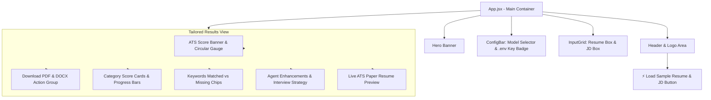

# Frontend System Design Document (SDD)
**Component:** Full-Stack Single Page Application (`fullstack-app/frontend`)  
**Living Spec Location:** `fullstack-app/frontend/docs/spec/README.md`  
**Status:** Living Spec / Active  
**Version:** 1.0.0  

---

## 1. Overview & UI Objectives

The frontend application provides a fast, responsive, and visually modern user experience built on **React 19** and **Vite**.

### Core Goals:
1. **Low Friction Input**: Dual-mode input allowing drag-and-drop file uploads (`.pdf`, `.docx`) or instant text pasting with pre-configured sample data.
2. **Clear ATS Transparency**: Real-time breakdown of ATS scores, keyword matching, and specific improvements made.
3. **Wysiwyg Document Preview**: A high-fidelity resume preview reflecting the downloaded document's layout and typography.
4. **Zero Key Management Hassle**: Automatically displays the active status of the internally configured `.env` Gemini key without prompting the user.

---

## 2. Design System & Tokens

Defined in `src/index.css`:

```css
:root {
  --bg-gradient: radial-gradient(circle at 15% 20%, #0d1527 0%, #060913 100%);
  --panel-bg: rgba(18, 25, 43, 0.7);
  --panel-border: rgba(255, 255, 255, 0.08);
  --primary: #38bdf8;
  --accent: #818cf8;
  --success: #34d399;
  --warning: #fbbf24;
  --danger: #f87171;
  --font-sans: 'Plus Jakarta Sans', -apple-system, sans-serif;
}
```

---

## 3. Component Hierarchy



---

## 4. State Management Contract

| State Variable | Type | Initial Value | Purpose |
|---|---|---|---|
| `resumeFile` | `File \| null` | `null` | Uploaded resume file object |
| `jdFile` | `File \| null` | `null` | Uploaded Job Description file object |
| `resumeText` | `string` | `""` | Manual resume text input |
| `jdText` | `string` | `""` | Manual Job Description text input |
| `modelName` | `string` | `"gemini-3-flash-preview"` | Active Gemini model selection |
| `loading` | `boolean` | `false` | Asynchronous tailoring progress state |
| `error` | `string \| null` | `null` | User-facing error message |
| `tailoredData` | `TailoredResumeResponse \| null` | `null` | Completed response payload from backend |
| `backendReady` | `boolean` | `false` | Backend health connectivity state |

---

## 5. User Flows

### Flow 1: Tailoring with Sample Data
1. User clicks **"⚡ Load Sample Resume & JD"** in header.
2. Sample text fields populate instantly.
3. User clicks **"Tailor & Score Resume"**.
4. Full tailoring request dispatches to backend; confetti fires on success.
5. ATS dashboard and rendered document preview render below.

### Flow 2: Custom Document Upload & Download
1. User drops `my_resume.docx` into Box 1.
2. User drops `target_job.pdf` into Box 2.
3. User clicks **"Tailor & Score Resume"**.
4. User inspects missing keywords and tailored XYZ bullet points.
5. User clicks **"Download PDF"** or **"Download DOCX"** to trigger browser file download.
