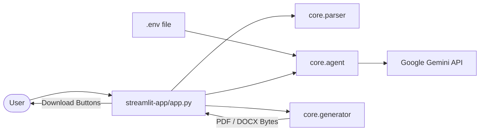

# Streamlit Application System Design Document (SDD)
**Component:** Streamlit All-in-One App (`streamlit-app`)  
**Living Spec Location:** `streamlit-app/docs/spec/README.md`  
**Status:** Living Spec / Active  
**Version:** 1.0.0  

---

## 1. Overview & Purpose

The Streamlit application (`streamlit-app/app.py`) provides an all-in-one, low-latency Python interface for developers, internal recruiters, and candidates who prefer a pure-Python execution environment without needing Node/React dependencies.

---

## 2. Architecture & Data Flow

---

## 3. UI Layout & Session State

### Session State Keys:
- `st.session_state["tailored_result"]`: Holds the `TailoredResumeResponse` instance after analysis.

### Visual Sections:
1. **Sidebar:**
   - Active Gemini key status badge (`🟢 Gemini API Key Active (via .env)`).
   - Gemini model dropdown (`gemini-3-flash-preview`, `gemini-3.5-flash`, `gemini-flash-latest`).
   - ATS standard checklist.
2. **Main Canvas:**
   - 2-Column Upload Form (`st.file_uploader` for PDF/DOCX and `st.text_area`).
   - Tailor CTA Button.
3. **Analytics Dashboard:**
   - 4 Metric cards (`Overall ATS Score`, `Keywords Matched`, `Missing Keywords`, `Formatting Compliance`).
   - Category progress bars (`st.progress`).
   - Matched and Missing keyword pill badges.
4. **Document Output:**
   - `st.download_button` for PDF (`application/pdf`).
   - `st.download_button` for DOCX (`application/vnd.openxmlformats-officedocument.wordprocessingml.document`).
   - Formatted markdown preview of the tailored resume.
